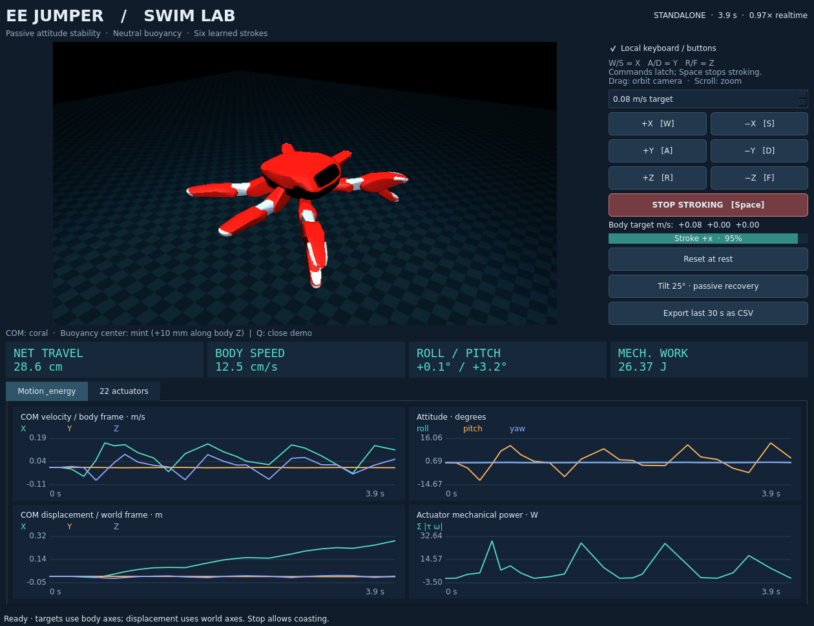

# EE Jumper

**A small MuJoCo swimming simulator with a PySide6 demo and ROS 2 control.**

[Jumper](https://github.com/KingKongRobotics/jumper)の22関節モデルを使い、
XYZの6方向に泳ぐ周期運動をCPUで学習するOSSです。必要な衝突モデルとメッシュ約1.2 MBだけを取り込み、
流体シミュレーション・学習・操作画面を独立して実装しています。Apache-2.0。



- **MuJoCo**: 抗力・揚力・中性浮力。浮心を重心の10 mm上に置き、roll / pitchが受動的に安定。
- **6方向の学習済み泳法**: 1秒周期、最大2 N·m。自由遊泳での正味移動量を重視したCEM探索。
- **PySide6**: 3D表示、XYZ操作、速度・姿勢・変位・機械パワーのグラフ、22関節一覧、CSV出力。
- **ROS 2**: `ros2 launch`で統合デモを起動。外部の`Twist`指令でも同じコントローラを利用。
- **Python API**: ROS / GUIを入れずに評価・学習できるGymnasium環境。

## デモを動かす

Python 3.10以上。Linux / ROS 2 Humble / Python 3.10で動作確認しています。
単体デモにROSやCUDAは不要です。

```bash
git clone https://github.com/hama6767/ee-jumper.git
cd ee-jumper
python3 -m venv .venv
source .venv/bin/activate
python -m pip install -e '.[gui]'
ee-jumper-gui --library examples/strokes-xyz.json
```

`gui`は検証済みのPySide6 6.8系（Qt Widgetsを含むEssentials）を使用します。Qt WebEngine等は不要です。
GUIにはOpenGLとデスクトップ表示が必要です。UbuntuでQtのxcbプラグインが起動しない場合は
`sudo apt install libegl1 libgl1 libopengl0 libxcb-cursor0 libxkbcommon-x11-0 libxcb-icccm4 libxcb-keysyms1`を確認してください。

| 操作 | 動作 |
|---|---|
| W / S、A / D、R / F | 機体X、Y、Zの正 / 負方向へ泳ぐ |
| Space / STOP STROKING | 関節をホームへ戻す。惰性は残る |
| Reset at rest | 位置・姿勢・計測をリセット |
| Tilt 25° | 傾けてリセットし、受動的に水平へ戻る様子を見る |
| ドラッグ / ホイール | カメラ回転 / ズーム |
| Q / Esc | 終了 |

指令はラッチ式です。キーを離しても継続し、Spaceで解除します。
速度指令は機体座標、変位グラフは世界座標です。仕事量は`∫Σ|τ·ω|dt`による機械仕事で、電池消費量ではありません。

## ROS 2から一括起動

リポジトリをワークスペースの`src/ee_jumper`へ配置し、上と同様に`.venv`を用意します。

```bash
source /opt/ros/humble/setup.bash
cd ~/dev_ws
colcon build --packages-select ee_jumper
source install/setup.bash
ros2 launch ee_jumper swim.launch.py
```

3Dと操作を含むPySide6の1画面が開きます。
外部ノードから操作するときは **Local keyboard / buttons** のチェックを外し、
`/ee_jumper/cmd_vel`へ`geometry_msgs/Twist`を送ってください。
画面が不要なら`viewer:=false teleop:=none`で起動できます。
[ROS設定・トピック・起動オプション](docs/ros_launch.md)。

## 学習・評価

```bash
# 描画なしで学習済みの1方向を評価
ee-jumper-stroke --library examples/strokes-xyz.json --direction +x --cycles 6 --headless

# 6方向を正味移動量で探索し直す（CPU、CEM）
ee-jumper-learn-displacement --warm-start examples/strokes-xyz.json \
  --generations 16 --population 20 --workers 4 --seed 51 \
  --period 1 --max-excursion 1.6 --output runs/strokes.json
```

現在のモデルで静止から6秒泳いだ変位は、+X **45.0 cm**、−X **42.4 cm**、
+Y **30.3 cm**、−Y **42.5 cm**、+Z **16.8 cm**、−Z **12.4 cm**です。
25°の傾きは、動作なしで10秒後にroll / pitchとも1°未満まで戻ります。
[計測と学習方法](docs/cycle_control.md)、[検証記録](docs/validation.md)。

## コードの入口

| ファイル | 役割 |
|---|---|
| `model.py` | 水中モデルと`step_water`。各物理ステップで浮心オフセットの復元トルクを計算 |
| `cycles.py` / `learn_displacement.py` | 周期軌道、測定、CEM探索 |
| `control.py` | 6方向の泳法を周期ごとに選ぶXYZ速度コントローラ |
| `simulation.py` | GUI / ROS共通のシミュレーションループ |
| `dashboard.py` / `ros_bridge.py` | PySide6表示 / ROSメッセージ変換 |
| `env.py` | Gymnasium環境。旧planar入門課題と任意の関節角アクション |

浮力付きモデルを直接進める場合は`mujoco.mj_step`の代わりに`ee_jumper.model.step_water`を使います。
コアテストは`pip install -e '.[dev]'`後、`PYTEST_DISABLE_PLUGIN_AUTOLOAD=1 pytest -q`で実行できます。

## モデルの範囲・ライセンス

完全水没を仮定した未校正の楕円体流体近似です。自由表面・後流の履歴・リンク間の流体干渉は扱いません。
浮心オフセットはシミュレーションの仮定であり、実機Jumperの浮力・防水性を表すものではありません。
受動安定化はroll / pitchに働き、yawや世界座標位置は保持しません。速度の厳密な追従も保証しません。

上流のApache-2.0ライセンスと帰属は[NOTICE](NOTICE)、[UPSTREAM_NOTICE](docs/UPSTREAM_NOTICE.txt)、
[モデルの出典・SHA-256](src/ee_jumper/assets/jumper/provenance.json)に記録しています。
元の関節範囲・質量・慣性を保持し、浮力用のダミー質量は追加していません。
[設計メモとクライミング案の比較](docs/design.md)、[貢献方法](CONTRIBUTING.md)。
