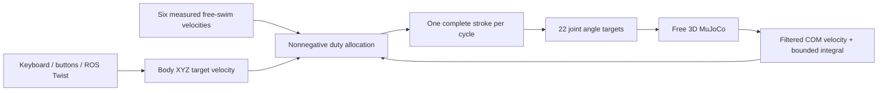

# XYZの正味移動量を学習する周期遊泳

学習済みの6方向は [`examples/strokes-xyz.json`](../examples/strokes-xyz.json) です。
**1秒周期**、ホーム姿勢から始まって戻る18関節の運動で、手首・指4関節は姿勢を保持します。
座標は機体Xが前、Yが左、Zが上です。通常の操作は
[ROS 2 launchによる一括起動](ros_launch.md)を使ってください。

現在は[PPOによる追加微調整](ppo_refinement.md)を反映しています。
18関節の制限を両端各10°拡張し、振幅上限1.8 radで+X・+Zの改善を採用しました。
以降の旧新比較はCEM導入時・浮心導入時の記録で、最新の比較はリンク先を参照してください。

## CEM導入時に変更したこと

- 振幅の探索上限を0.9 radから1.6 radに拡大。ただし各関節の可動域の90%以内に収めます。
- 周期を1.2秒から1秒に短縮。元モデルの関節範囲と2 N·mのサーボトルク上限は維持します。
- 胴体を固定した推力から、**自由な3D状態での6秒間の全体重心の正味変位**へ学習目的を変更しました。
- ROSの使用率も、固定胴体の流体トルクに制限されない実測遊泳速度から割り当てます。
- キーボードの既定指令を0.08 m/sに変更。上限は0.1 m/sです。

大きく振るだけでは戻す動作の抵抗も増え、前進が減る場合があります。
今回の探索は、押す動作と戻す動作を含む実際の移動量で候補を比較しています。
位置を直接書き換えたり、人工的な並進推力・姿勢固定を加えたりはしていません。

## 大振幅化の比較（浮心オフセット導入前）

測定結果は学習終了後に同条件で再計測し、
[`examples/displacement-comparison.json`](../examples/displacement-comparison.json) に保存しています。
旧データは直前の速度優先版 [`examples/strokes-xyz-speed-v1.json`](../examples/strokes-xyz-speed-v1.json)、
さらに初期の効率優先版は [`examples/strokes-xyz-efficiency.json`](../examples/strokes-xyz-efficiency.json) です。

| 方向 | 前回の6秒移動 cm | 今回の6秒移動 cm | 倍率 | 横方向へのずれ cm | 実関節の最大角度幅（旧→新） |
|---|---:|---:|---:|---:|---:|
| +X | 9.17 | 44.36 | 4.84 | 0.73 | 49.0° → 85.6° |
| -X | 20.56 | 42.83 | 2.08 | 1.04 | 43.2° → 78.9° |
| +Y | 14.64 | 30.44 | 2.08 | 1.41 | 37.8° → 65.8° |
| -Y | 16.53 | 42.78 | 2.59 | 2.96 | 47.4° → 69.2° |
| +Z | 5.34 | 16.96 | 3.18 | 1.85 | 38.2° → 101.5° |
| -Z | 6.50 | 12.88 | 1.98 | 2.27 | 35.0° → 43.4° |

同じ初期ホーム姿勢・中性浮力・流体・サーボ設定で、静止から6秒間泳がせています。
角度幅は、各関節が実際に動いた最大角度と最小角度の差のうち最大の値です。
前回比で全6方向の正味移動量が増えています。固定胴体の推力だけの比較ではありません。

0.08 m/sの指令を10秒間与えたROSと同じ制御ループでの移動量は、
+X 75.4 cm、-X 71.0 cm、+Y 51.8 cm、-Y 71.7 cm、+Z 27.9 cm、-Z 22.1 cmでした。
目標どおりなら80 cm進む条件です。上下方向は目標より遅く、方向によって到達速度が異なります。
細かい時間刻みでの6秒変位の差は 0.14〜0.37%でした。
上記は浮心オフセット導入前の記録です。現在の検証原本は次節に示します。


## 浮心を10 mm上げた時点のモデル（PPO微調整前）

既存の6泳法の係数を保持し、受動安定化を加えたモデルで自由遊泳・固定推力計の両方を再計測しました。
この時点のライブラリは `examples/strokes-xyz-cem.json` です。
浮心導入時には泳法の再学習は行っていません。結果は [`passive-swimming-comparison.json`](../examples/passive-swimming-comparison.json) に保存しています。

| 方向 | 6秒変位 cm | 最大姿勢変化（導入前 → 現在） |
|---|---:|---:|
| +X | 44.97 | 16.7° → 13.3° |
| -X | 42.44 | 23.4° → 9.7° |
| +Y | 30.34 | 23.5° → 7.6° |
| -Y | 42.53 | 26.0° → 12.4° |
| +Z | 16.77 | 20.1° → 16.5° |
| -Z | 12.38 | 14.8° → 4.2° |

姿勢変化はyawも含む初期姿勢からの回転角です。復元作用があるのはroll / pitchです。
0.08 m/sを10秒指令したときの軸方向変位は、+X 76.6 cm、-X 71.5 cm、+Y 51.7 cm、-Y 71.3 cm、+Z 27.5 cm、-Z 21.0 cmでした。
物理刻み0.5 ms・制御5 msへの変更による6秒変位の差は 0.13〜0.31%です。
最新の検証原本: [`strokes-validation.json`](../examples/strokes-validation.json)（PPO採用後の値へ更新）。

## 軌道と評価

18関節に2係数ずつ、合計36係数を探索します。

```text
u = time / period
phi = 2*pi*u - sin(2*pi*u)
q_j = home_j + scale_j * (a_j/2 * (1-cos(phi)) + b_j*sin(phi))
```

周期境界では目標角度がhomeへ戻り、目標角速度・角加速度もゼロになります。
`a_j, b_j` は [-1, 1] です。スケールは最大振幅と関節範囲から計算します。
通常の方向切り替えは1周期の境界で行います。

学習評価は次の式です。距離は経路長ではなく、始点から終点への**全体重心**の変位です。
脚を胴体に対して振っただけの見かけの移動は、全体重心の移動には数えません。

```text
d_axis  = dot(COM_end - COM_start, commanded_direction)
d_cross = norm(displacement - d_axis * commanded_direction)
score = d_axis - 0.4*d_cross - 0.03*peak_rotation - 0.0001*cycle_work
        - 1.5*max(0, peak_rotation - 0.45)
```

`cycle_work` は6秒間の平均的な1周期あたりの絶対機械仕事です。
消費エネルギーの項は小さくし、移動量と横流れ・姿勢の維持を優先します。
電池消費、モーターの待機電力・銅損、回生を予測した値ではありません。

最終候補は指定軸方向への移動が正、横方向の変位が軸方向変位の75%以内、
最大姿勢変化0.6 rad未満、アクチュエータトルク2 N·m以下、貫通0.5 mm以下、不安定化なしを条件にします。
逆動力学で処方した動作ではなく、位置サーボで実際に動かした状態を評価します。

探索は物理刻み2 ms・制御刻み20 msで行い、候補を物理1 ms・制御10 msで再評価して選びます。
別途、物理0.5 ms・制御5 msでも正味変位と周期平均推力を検証します。
探索条件・seed・世代ごとの成績・係数・計測値はJSON内に保存しています。
この軌道族と有限回の探索で得た結果であり、大域最適性を示すものではありません。

```bash
source .venv/bin/activate
ee-jumper-learn-displacement --warm-start examples/strokes-xyz-speed-v1.json \
  --period 1 --max-excursion 1.6 --generations 16 --population 20 \
  --workers 4 --seed 51 --output runs/strokes-displacement.json
```

## 1ループの流体力を計測する方法

従来どおり、各泳ぎ方の静止した推力計での計測値もJSONの `metrics` に記録します。

```text
impulse = integral(F_fluid(t), dt)              [N·s]
mean_force = impulse / period                  [N]
work = integral(sum(abs(tau_j * qdot_j)), dt)    [J]
```

自由基部の一般化力 `(qfrc_passive - qfrc_gravcomp)[:3]` を使います。
この基部にはバネ・ダンパーがないため、浮力を差し引くと流体力になります。
脚の加減速による内部反力を推進力として加算しません。
トルクは `base_link` 原点周り・機体座標であり、全体重心周りのトルクとは異なります。

**v2ライブラリは自由遊泳の変位・横流れ・姿勢で合否判定します。**
固定胴体の平均流体トルク0.002 N·m以下という旧制約は、実際によく進む動作を除いていたため、
診断値として残し、泳ぎ方の採否には使いません。
`quality` は従来の固定胴体の診断、`displacement_quality` は現在の採否です。
再生時には形式に対応した評価を再計算し、不適合なライブラリを読み込みません。

## 再生と中性浮力

```bash
ee-jumper-stroke --library examples/strokes-xyz.json --direction +x --cycles 6
ee-jumper-stroke --library examples/strokes-xyz.json --direction=-z --cycles 6
ee-jumper-stroke --library examples/strokes-xyz.json --idle --cycles 30

# GUIなしで測定
ee-jumper-stroke --library examples/strokes-xyz.json --direction +y --headless --cycles 6

# GIF保存（renderの追加依存が必要）
MUJOCO_GL=egl ee-jumper-stroke --library examples/strokes-xyz.json \
  --direction +x --cycles 3 --gif runs/swim.gif
```

浮力は各リンクの `gravcomp = water.density * buoyancy_ratio / 1000` としてモデルに設定します。
標準値1ではリンク重心に重力と反対向きの同じ力が働きます。
描画同期がクリアする外力配列 `xfrc_applied` に依存しないため、描画・リセット後も維持されます。
静水中の水平な無操作状態は静止します。浮心は全体重心から機体+Zへ10 mmずらしています。
`step_water`は各物理ステップで `r_CB × F_b` を復元トルクとして加え、傾きから自然に戻します。
これは位置エネルギー `U = -F_b · r_CB` に対応する受動的な作用で、減衰は流体抵抗によります。
外力配列はステップ後に元に戻すため、ビューアによる外力クリア後も再計算されます。
25°のroll / pitchは10秒後に1°未満になります。yawには復元トルクがありません。
泳いだ後は惰性が残り、流体抵抗で減速します。

## ROSでの割り当て



関節角軌道を足し合わせず、学習した1周期を丸ごと選びます。
複数軸の指令は周期単位の時間配分で扱い、使用率の和は1以下、残りはidleです。
v2は実測自由遊泳速度の行列を使い、速度誤差・制限付き積分で補正します。
非線形流体の時間配分を近似する制御であり、厳密な速度追従や姿勢保持を保証するものではありません。
旧v1ライブラリは従来の力行列による制御で再生できます。

`/ee_jumper/cmd_vel` は機体座標の `geometry_msgs/Twist.linear.{x,y,z}`、angularは未使用です。
0.5秒間指令が届かなければ周期を中断し、0.3秒でホームへ補間します。
ゼロ指令でもホームへ戻ります。瞬時に速度をゼロにするブレーキではありません。

## 検証と限界

```bash
PYTEST_DISABLE_PLUGIN_AUTOLOAD=1 pytest -q
python scripts/compare_swimming.py --output runs/displacement-comparison.json
python scripts/validate_cycles.py --library examples/strokes-xyz.json --speed 0.08
python scripts/check_neutral_buoyancy.py --viewer
```

ROSの実起動・入力・終了は [launchの検証方法](ros_launch.md#検証) を使います。
6秒の開ループ遊泳と、10秒の速度指令を別に計測しています。
姿勢保持専用の動作、流速ごとの推力マップ、世界座標の位置追従は未実装です。
流体は未校正の楕円体近似、完全水没・静水・リンクごとの中性浮力です。
自由表面、後流の履歴、リンク間の流体干渉、実機の防水性は扱いません。

参考: [MuJoCo gravcomp](https://mujoco.readthedocs.io/en/stable/XMLreference.html#body-gravcomp)、
[流体モデル](https://mujoco.readthedocs.io/en/stable/computation/fluid.html)。
